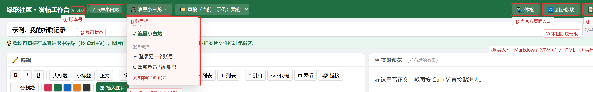
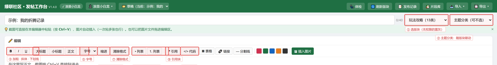

# 绿联社区发帖工作台 V1.4.0：写给还在跟编辑器较劲的你

先说清楚它是什么：**一个装在你自己电脑上的发帖辅助工具**。
不联网收集数据、不碰你的账号密码以外的东西，唯一干的事就是——帮你把图文混排的帖子
更舒服地写出来，再稳稳当当地发到绿联社区。

我自己在社区写了不少折腾记录，最烦的不是折腾本身，而是**写帖这个过程**：
官方编辑器插图要一张张传、插错位置只能清空重来、写了一半换窗口内容没了、
发不出去只给一句看不懂的报错、写完这篇下次又要把同样的开头结尾再打一遍。
所以干脆自己搓了个工具，现在它已经在迭代到 V1.4.0，拿出来给同样爱折腾的朋友用。

下面两张图把界面上的按钮都标了出来，红框 + 编号，对着看一眼就明白：

顶部右边那一排，从左到右：**体检**（查官方发帖页有没有变）、**刷新版块**（重扫各账号在各版块的权限）、
**发布记录**（你发过的帖子档案，能载入再发一次、能查审核状态）、**片段库**（常用段落一键插入）、
**导入 ▾ / 导出 ▾**（Markdown 和 HTML 都能来去，HTML 导出会把图片内嵌成单个文件）。
左边是版本号、登录状态、账号柜（切换/登录/移除账号）、草稿切换。

写正文时用的都在这一条：加粗斜体下划线、标题层级、**字号**、**首行缩进**、**清除格式**、
列表、引用、代码块。右上角是选**版块**和**主题分类**（分类跟着版块联动）。

## 它能帮你干什么

**写和排版**
常用的加粗、标题、列表、引用、代码块都有，另外加了三个用得上的：
**字号**（特小到特大，发出去不会变形）、**首行缩进**（中文帖惯例，一点就两格）、
**清除格式**（一段花里胡哨的样式，一键洗干净）。

**插图**
截图直接按 Ctrl+V 粘贴，图片文件也能拖进编辑区，一次粘多张也行。
插错了不用清空重写——点一下图片会弹出小工具条，**上移/下移/删除**，
按住图片拖到别的位置也能换顺序。

**片段库**
每次都要写的开头寒暄、设备信息表、免责声明，存成片段一键插入。
首次使用会预置 4 条通用示例，你可以自己新建、改名、删除。
另外有个「📊 高频统计」：它会扫你本机的发布记录和当前编辑器，
找出你重复写得最多的句子和短语，勾选就能存成片段。
**原理是纯文本计数**——不联网、不用 AI、毫秒级跑完、结果只存你自己电脑，
这一点我放在功能说明里写清楚，是因为隐私这事不能含糊。这个功能可以在设置里关掉。

**发布记录**
用「直接发布」发出去的帖子会自动记下来（时间、版块、账号、链接、正文），
以后可以一键载入改完再发一次，相当于给你自己的帖子做了个档案库。
每条记录带状态：**✅ 已发布 / ⏳ 待审核 / ❌ 未过审**。
审核结果论坛没有公开接口查，所以加了个「🔍 检测状态」——
用你已登录的浏览器后台打开帖子看一眼，状态自动更新。
用「填入编辑器」手动发的帖子，点「＋ 补记录」把链接补进去就行。

**导入导出**
顶栏「📥 导入 ▾」支持 Markdown（配图一起选）和 HTML 文件；
「💾 导出 ▾」支持 Markdown 和 **HTML 单文件**——HTML 会把图片全部内嵌，
双击就能看，整篇复制粘贴回论坛图片也跟着走。

**发不出去时的排错**
这是我最花心思的部分：
- 右上角「🩺 体检」：检查官方发帖页的 10 个结构锚点有没有变（官方改版最先在这里露出苗头），并告诉你当前生效的是哪套写法；
- 官方哪天真改版了，自动链路挂掉也不会让你卡死——失败弹窗里给了
  **「复制全文 + 打开官方发帖页」**，手动粘贴照样发得出去；
- 发布前有**检查清单**：标题超 80 字、正文太短、只有图没字、
  距上次发帖不足 60 秒（官方限流）都会拦下来提醒你；
- 实在搞不定就点右下角的绿球下载诊断包发给我，包里没有账号密码、没有昵称、没有你电脑的路径。

**多账号**
账号柜可以存多个账号，切换后自动按那个号扫描版块权限——
哪个号能在哪个版发，界面上直接标出来，不用挨个试。

## 怎么装

下载 exe 安装版，双击一路下一步就行。
Windows 可能弹「未知发布者」的蓝色提示（没做代码签名，个人开发者成本太高），
点「更多信息 → 仍要运行」即可。程序装在用户目录，卸载时可以选择保留登录态和草稿。
顺带一提：卸载是真干净，它会先结束正在运行的工作台再删文件，不会给你留个 node.exe 在后台。

## 怎么用（就五步）

1. 打开后按提示**登录**绿联社区账号（第一次需要扫码/账号密码，之后记住登录态）
2. 在左边编辑器里**写**，截图直接 Ctrl+V 粘贴
3. 右边选好**版块**和**主题分类**（没权限的版块会置灰）
4. 点「**填入论坛编辑器**」——它会打开论坛发帖页把内容填好，你自己检查一遍再点发表；
   想一步到位就点「**直接发布**」
5. 发完帖子自动进「📝 发布记录」

## 关于隐私，说三遍都不多

这是个**纯本地工具**：帖子内容、图片、登录凭证全部存在你自己电脑的用户目录里，
不联网上传、不云同步、不收集任何使用数据。它不需要联网就能写，
只有登录和发帖时才访问绿联社区——用的还是你自己的浏览器和账号。

## 反馈

用着别扭、发不出去、或者想要什么功能，右下角绿球下载诊断包，
微信搜一搜「很多问题的小明同学」发给我。也可以直接在评论区说，我看到就改。

工具是 MIT 开源许可证，作者署名保留，禁止冒名和商用冒用。
希望它能帮你在社区少花点时间跟编辑器较劲，多点时间折腾真正的乐趣。
