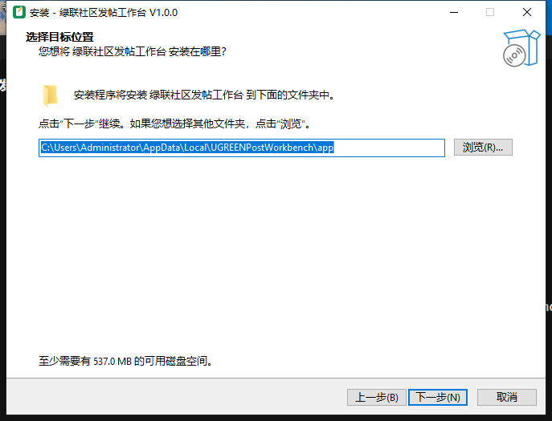

# 排版压测稿：一次塞进所有元素

> 这份稿件是「绿联社区发帖工作台」的排版极限测试文件，全文超过五千字，
> 覆盖中英文混排、生僻字、全角半角、特殊符号、表情符号、表格、代码块、
> 超链接、图片、动图、HTML 片段等几乎所有常见元素。目的只有一个：
> 把编辑器和导入链路里可能藏着的bug一次性全部逼出来。
> 如果这份稿子导入后显示一切正常，那日常使用的稿件就更不会有问题了。

## 一、中文长段落：检验自动换行与字距

在数字世界的角落里，总有一群人热衷于把家里的小主机折腾成个人的数据中心，
绿联NAS就是这条路上最常见的伙伴之一。从开箱、插盘、组RAID，到装Docker、
跑虚拟机、挂载网盘，每一步都充满了惊喜与意外。有人为了一个Docker镜像的
网络模式研究到凌晨三点，也有人为了SMB传输速度只有20MB/s而重刷整个系统。
折腾的意义从来不只是省下几百块的云服务费，而是在这个过程中，你真正理解了
数据是如何存储、如何流转、如何被保护的。当你把家人的照片、自己的工作文档、
孩子的成长视频全部放在自己亲手搭建的机器上，并且做好了三二一备份策略的
那一刻，你获得的安心感是任何网盘会员都无法给予的。这就是私有云的魅力，
也是我们愿意花一个周末去折腾一台NAS的全部理由。折腾不是目的，掌控感才是；
省钱的快乐会过期，学到的东西不会。希望你也能在这条路上找到自己的乐趣，
少踩坑、多备份，遇到问题多查文档、多看日志，毕竟数据无价，且行且珍惜。
这一段是故意写得很长的中文段落，用来检验编辑器在长文本下的换行是否自然、
段间距是否正常、预览区是否会出现横向滚动条或者文字重叠的现象。如果这段
文字在预览里看起来一切正常，那么日常帖子的排版就基本稳了。

## 二、English paragraph: mixing words and punctuation

This paragraph is intentionally written in English to test how the editor
handles long Latin text without CJK line-breaking rules. Words like
"configuration", "specifications", and "troubleshooting" are quite long,
and combined with punctuation such as commas, periods, semicolons, colons,
quotation marks "like this", apostrophes like it's and they're, parentheses
(both round and square [brackets]), dashes — em dashes too — plus slashes
and/or ampersands & symbols, they can reveal subtle layout issues. Numbers
should render correctly as well: 3.14159, 1,048,576, 2^10 = 1024, 50%,
$199.00, ¥1,299, 12:34:56, 2026-10-20, and version strings like v1.0.0-beta.
If this paragraph wraps cleanly in the preview pane, mixed-language posts
are safe to write.

## 三、中英混排与全角半角：最容易出问题的场景

这是一段典型的中英混排文字：我昨天用绿联NAS（型号DXP4900）跑了一个Docker
容器，内存占用只有128MB（约0.125GB），CPU峰值不过15%，比预期好很多。
它的官方网站是 https://www.ugnas.com ，文档地址在 https://www.ugnas.com/docs
（注意链接里带斜杠）。全角标点：，。！？；：「」『』（）《》【】——……
半角标点: , . ! ? ; : " ' ( ) [ ] { } < > ~ @ # $ % ^ & * _ + = | \
数字对比：全角１２３４５ vs 半角12345；字母对比：全角ＡＢＣ vs 半角ABC。
单位符号：℃、℉、°、±、×、÷、≈、≠、≤、≥、∞、∑、π、µ、Ω。
序号符号：①②③④⑤⑥⑦⑧⑨⑩、Ⅰ Ⅱ Ⅲ Ⅳ Ⅴ、ⒶⒷⒸ。
勾选符号：✓ ✔ ✗ ✘ ☑ ☒。箭头：← → ↑ ↓ ↔ ⇒ ⇔ ➜ ➤。星号花号：★☆✦✧✩✪❋❊。
牌类花色：♠ ♥ ♦ ♣ ♤ ♡ ♦ ♧。天气符号：☀ ☁ ☂ ☃ ☼ ☽ ❄。音乐：♪ ♫ ♬ ♩。
生僻字测试：𠮷野家（这个字读jí）、龘、鱻、麤、飝、嫑、嘦、勥、巭、氼。
如果以上所有字符都能正常显示，说明Unicode覆盖没有问题。

## 四、表情符号：从功能到情绪全覆盖

功能类：📌数据 💡结论 ⚠️风险 ✅已完成 ❌未完成 🔥热门 ⭐重点 📌置顶
情绪类：😂 🤣 😭 😱 💸 😍 🤔 😴 🥱 😎 🥳 😇 🙃 😅 😩 🤯
手势类：👍 👎 👌 ✌️ 🤝 👏 💪 🙏 👀 🖐️
设备类：💻 🖥️ ⌨️ 🖱️ 📱 💾 📀 🗄️ 🔌 🔋 📡 🛰️
动物类：🐶 🐱 🐭 🐰 🦊 🐻 🐼 🐨 🐯 🦁 🐮 🐷
食物类：🍔 🍟 🍕 🌭 🍿 🧋 ☕ 🍵 🍺 🍉 🍇
组合测试：👍+1、💯分、🎯目标、🚀起飞、⚡加速、🎨美化、🔧修理、📦打包、🗑️删除
连续表情：😂😂😂🤣🤣🤣、👍👍👍👍👍、🎉🎉🎉🎉🎉🎉🎉
旗帜：🇨🇳 🏮，国旗组：🇺🇸🇯🇵🇰🇷🇬🇧🇩🇪（检验国旗字母对是否正常渲染）

## 五、行内样式：加粗、斜体、删除线、行内代码

**这里是一段加粗文字**，用来检查 strong 标签；*这里是一段斜体文字*，
用来检查 em 标签；~~这里是一段删除线文字~~，用来检查 del 标签；
`这是一段行内代码 const answer = 42;`，用来检查 code 标签；
***这里是加粗加斜体***，两者叠加；**加粗里包含*斜体***的嵌套写法。
下划线和删除线在 Discuz 里没有原生 md 语法，所以用 HTML 补：
<u>这是HTML下划线</u>，<s>这是HTML删除线</s>，<b>这是HTML加粗</b>，
<i>这是HTML斜体</i>，<font color="#c0392b">这是font红字（老式写法）</font>，
<span style="color:#1565c0">这是span蓝字（style写法）</span>，
<mark>这是mark高亮</mark>，<kbd>Ctrl</kbd> + <kbd>C</kbd> 键盘按键样式。
安全测试段：<script>alert('XSS测试')</script>，javascript:alert(1) 链接，
，<iframe src="https://evil.com"></iframe>。
以上四段恶意代码应该被净化或转义成纯文本显示，绝不能执行。

## 六、代码块：注释里也要有中文

```bash
# 一键检测NAS磁盘健康状态（bash 示例）
smartctl -a /dev/sda | grep -E "Reallocated_Sector_Ct|Current_Pending_Sector"
echo "如果 Reallocated 大于 0，说明硬盘已经有坏道重映射，建议尽快更换"
df -h | grep -v tmpfs
```

```javascript
// 前端示例：防抖函数（debounce）
function debounce(fn, wait = 300) {
  let timer = null;
  return function (...args) {
    clearTimeout(timer);
    timer = setTimeout(() => fn.apply(this, args), wait);
  };
}
const 搜索框输入处理 = debounce((关键词) => {
  console.log('搜索:', 关键词); // 中文变量名与中文注释混排
}, 500);
```

```python
# Python 示例：批量重命名文件
import os
from pathlib import Path
文件夹 = Path("E:/照片备份/2026-10")
for 序号, 文件 in enumerate(文件夹.glob("*.jpg"), start=1):
    新名字 = f"2026国庆_{序号:03d}.jpg"
    文件.rename(文件夹 / 新名字)
    print(f"已重命名: {文件.name} -> {新名字}")
```

行内代码中的特殊字符也要能活下来：`C:\Users\你的用户名\AppData\Local`，
`npm install --save-dev eslint@^8.0.0`，`{{mustache}}模板`，`<div class="x">`，
`SELECT * FROM users WHERE name='张三' AND age>18;`，`a || b && !c`。

## 七、引用与嵌套

> 这是一层引用：数据无价，且行且珍惜。备份策略请记住 3-2-1 原则——
> 3 份数据、2 种介质、1 份异地。
>
> 这是引用里的第二段：NAS 不是买来就一劳永逸的，RAID 不是备份，
> 它只防硬盘物理故障，不防误删除和勒索病毒。

## 八、列表：无序、有序、嵌套

- 硬件层
  - 主机：绿联 DXP4900（Intel N100，4盘位）
  - 硬盘：希捷酷狼 8TB × 2（RAID1 镜像）
  - 内存：板载 8GB DDR5（暂时够用）
- 系统层
  1. UGOS Pro 出厂系统（日常够用）
  2. 备选：fnOS 飞牛（ARM 版口碑不错）
  3. 进阶：PVE / ESXi 虚拟化全家桶
- 软件层
  - Docker 套件
    - Jellyfin（影音库）
    - qBittorrent（下载机）
    - Home Assistant（智能家居）
  - 虚拟机套件
    - Windows 11 轻量办公
    - OpenWrt 软路由

1. 第一步：备份数据（重要的事情说三遍：备份、备份、备份）
2. 第二步：升级内存与固件
3. 第三步：配置远程访问（Zerotier / Tailscale 二选一）
4. 第四步：设置自动快照
5. 第五步：写一篇折腾笔记发到社区

## 九、表格：对齐与长内容

| 部件 | 型号 | 价格（¥） | 备注 |
|:-----|:----:|----:|------|
| 主机 | 绿联 DXP4900 | 2,699 | 四盘位，N100 处理器 |
| 硬盘 ×2 | 希捷酷狼 8TB | 1,199/块 | NAS 专用，CMR 垂直记录 |
| 内存 | 板载 8GB DDR5 | 0 | 不可更换，暂时够用 |
| UPS | 山特 TG-BOX 600 | 299 | 断电保护，撑 15 分钟 |
| **合计** | — | **约 5,400** | 每年电费约 180 度 |

长内容测试：这一格故意放很长的文字，用来测试表格在窄屏下的换行表现——
NAS 的意义在于把你散落在各处的数据（手机相册、电脑文档、摄像头录像、
下载的电影）统一收纳、统一备份、统一访问，并且在数据安全和访问速度之间
取得一个你可以接受的平衡点，这正是私有云相对于公有云最大的差异化价值所在。

## 十、分隔线与超链接

---

以上是分隔线。下面是各种链接：

- 官网直链：https://www.ugnas.com
- 带路径的链接：https://club.ugnas.com/forum.php
- 带参数的链接：https://www.baidu.com/s?wd=绿联NAS&ie=utf-8
- 中文锚文本：[绿联官方社区](https://club.ugnas.com)
- 英文锚文本：[Discuz! official site](https://www.discuz.net)
- 图片链接复合测试：[](https://club.ugnas.com)
- 无协议链接测试：www.ugnas.com（没有 https 前缀，看会不会被误处理）

## 十一、图片：静态图、截图、动图

静态图标（PNG 小图）：


界面截图（PNG 大图，检验压缩与缩放）：



动态图（GIF，检验动图是否被正确识别与上传）：


## 十二、超长不换行测试

下面这一行是故意不放空格的超长字符串，用来测试溢出处理：
ABCDEFGHIJKLMNOPQRSTUVWXYZabcdefghijklmnopqrstuvwxyz0123456789ABCDEFGHIJKLMNOPQRSTUVWXYZabcdefghijklmnopqrstuvwxyz0123456789ABCDEFGHIJKLMNOPQRSTUVWXYZabcdefghijklmnopqrstuvwxyz0123456789
如果上面的字符串把预览区撑出横向滚动条，说明 overflow 处理还有优化空间；
如果它自动断行了，说明处理得很稳。

## 十三、收尾：字数填充段

这篇压测稿到这里已经覆盖了绝大多数常见排版元素，最后再用几段文字把总字数
推过五千字大关。写作是一件反直觉的事情：你以为灵感来了会文思泉涌，实际上
大多数时候是打开编辑器、盯着光标、删了又写、写了又删。工具的意义就在于把
"写"以外的摩擦降到最低——排版不用你操心，插图不用你折腾，格式不用你调整，
你只需要专注于把想法变成文字。这也是我做这个发帖工作台的初衷：把截图粘贴、
图片上传、版块权限、格式转换这些机械劳动全部自动化，让创作者把时间留给
内容本身。好工具的最高境界不是功能多，而是让你感觉不到它的存在。

折腾NAS的这一年里，我最大的收获不是学会了多少命令行，而是建立了对数据的
敬畏之心。硬盘会坏、系统会崩、误删随时可能发生，唯一能保护你的只有纪律：
定期备份、多重冗余、异地容灾。希望每一个看到这篇帖子的人，都能在今天晚上
睡前检查一下自己的备份策略。如果你还没有备份，现在就去买一块硬盘，把重要
数据复制一份——这是你能为自己做的最有价值的一笔投资，没有之一。

最后感谢绿联社区提供了一个交流的平台，也感谢每一位认真写帖子的分享者。
社区的质量取决于每个人的付出：多写实测、少发水贴、认真回复、友善讨论。
如果这篇压测稿帮你在发帖前发现了排版问题，欢迎在评论区告诉我；如果你
发现了新的显示异常，也请截图反馈给作者，我们一起把这个工具打磨得更好。

—— 完 ——
